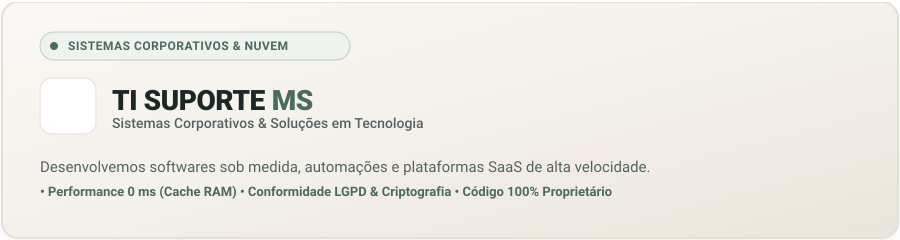
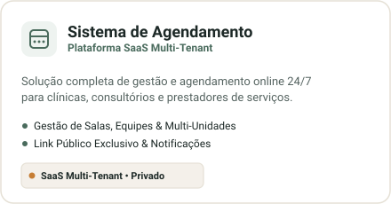
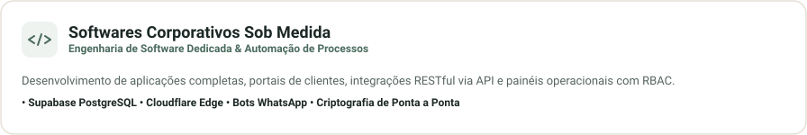

  

&nbsp;

  

  

  

---

  
   
  <b>Idealizado e Desenvolvido por:</b> 
  <a href="https://github.com/mickael-soares"><b>Mickael Soares</b></a> • <i>Founder &amp; Lead Engineer</i>
    
  
  

