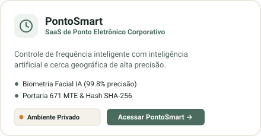
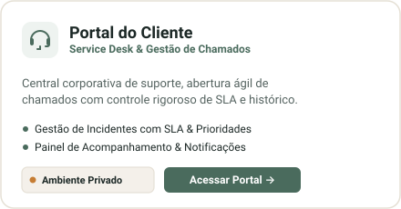
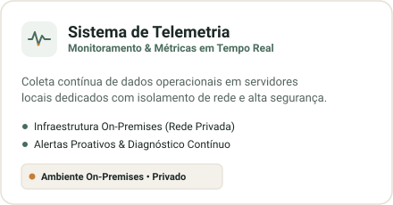

  

  
  &nbsp;
  

  
  &nbsp;
  

  

 

  

---

  Idealizado e Desenvolvido por: 
  <a href="https://github.com/mickael-soares"><b>Mickael Soares</b></a> • <i>Founder &amp; Lead Engineer</i>
    
  
  &nbsp;
  

